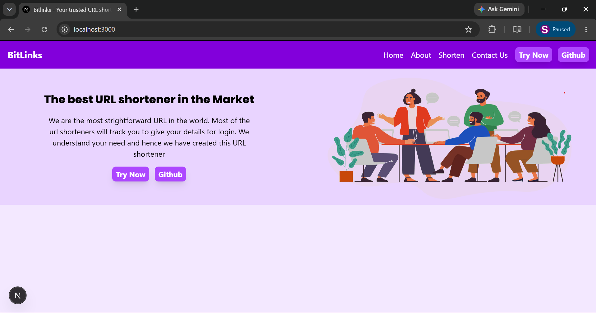
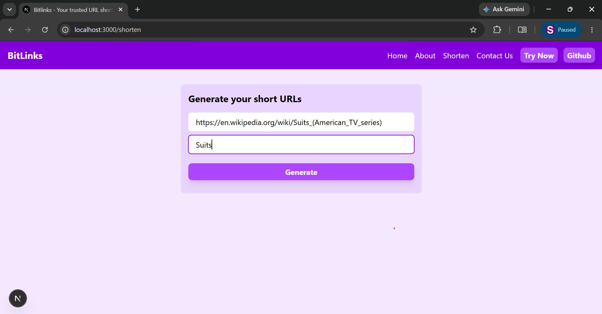
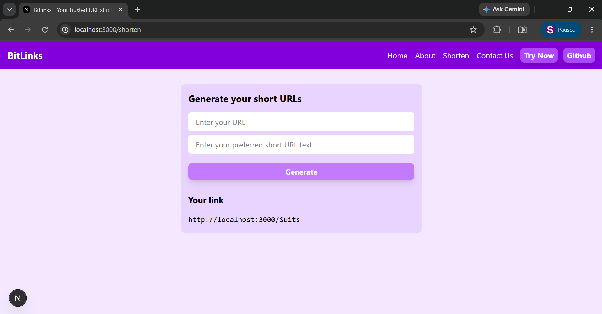
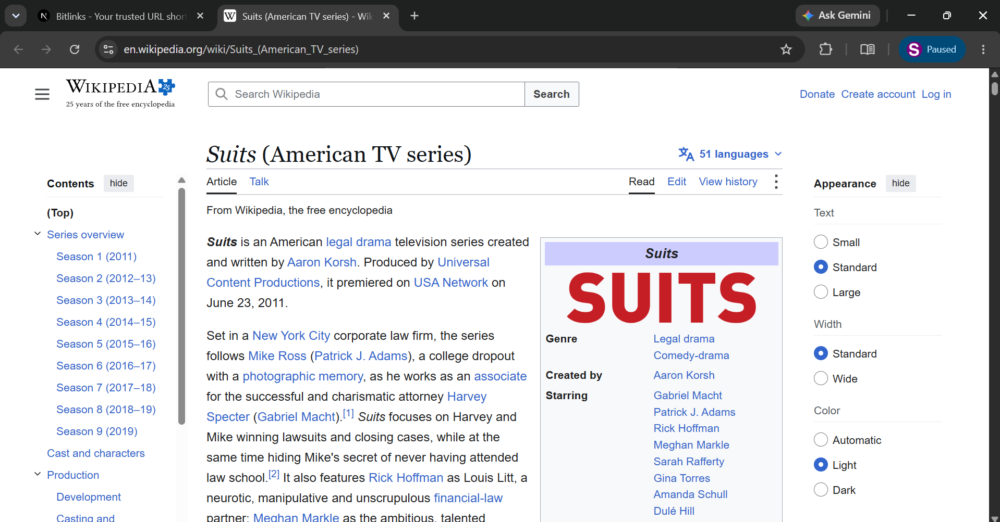
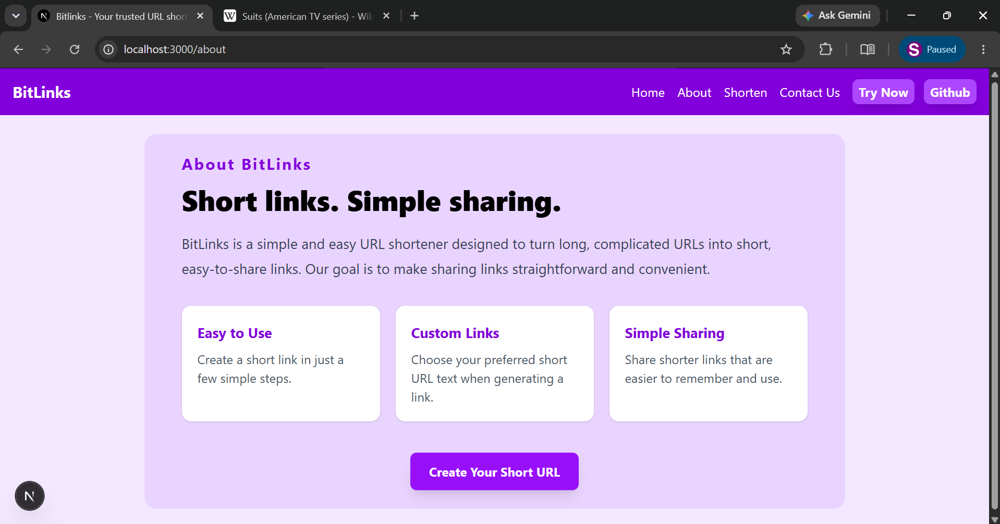
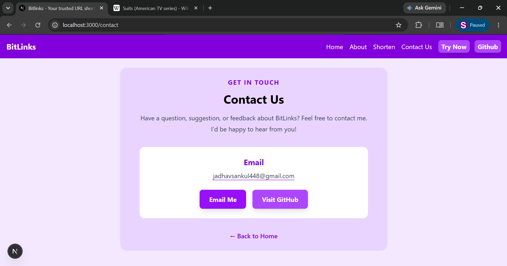

# 🔗 BitLinks — URL Shortener

A full-stack URL shortener built using **Next.js, React, Tailwind CSS, and MongoDB**. BitLinks allows users to convert long URLs into short, customizable links that are easy to share and remember.

## 📸 Screenshots

### 🏠 Home Page


### 🔗 URL Shortener Page




### ℹ️ About Page


### 📩 Contact Page


## ✨ Features

- Shorten long URLs using custom short identifiers.
- Check for duplicate short URL identifiers.
- Store URL mappings in MongoDB.
- Generate URLs through Next.js API routes.
- Responsive UI styled with Tailwind CSS.
- Dedicated Home, About, Shorten, and Contact pages.

## 🛠️ Tech Stack

- **Frontend:** Next.js, React
- **Styling:** Tailwind CSS
- **Backend:** Next.js API Routes
- **Database:** MongoDB
- **Language:** JavaScript
- **API Testing:** Postman
- **Version Control:** Git and GitHub

## ⚙️ Getting Started

### 1. Clone the repository

```bash
git clone https://github.com/sankul-jadhav/BitLinks.git
```

### 2. Navigate to the project directory

```bash
cd BitLinks
```

### 3. Install dependencies

```bash
npm install
```

### 4. Configure environment variables

Create a `.env.local` file in the project root:

```env
MONGODB_URI=your_mongodb_connection_string
NEXT_PUBLIC_HOST=http://localhost:3000
```

Replace the placeholder with your actual MongoDB connection string. Never upload your credentials to GitHub.

### 5. Run the application

```bash
npm run dev
```

Open [http://localhost:3000](http://localhost:3000) in your browser.

## 🔌 API Endpoint

**Generate a Short URL**

- **Method:** `POST`
- **Endpoint:** `/api/generate`

Example request:

```json
{
  "url": "https://example.com/a-long-url",
  "shorturl": "my-link"
}
```

## 📚 Key Learnings

- Next.js App Router and Route Handlers
- React state management using `useState`
- HTTP requests using the Fetch API
- MongoDB integration
- API testing with Postman
- Tailwind CSS
- Git and GitHub

## 🚀 Future Improvements

- Redirect short URLs to their original destinations.
- Add URL validation and better error handling.
- Implement user authentication.
- Add click tracking and link analytics.

## 👨‍💻 Developer

**Sankul Jadhav**

- GitHub: [sankul-jadhav](https://github.com/sankul-jadhav)
- Email: [jadhavsankul448@gmail.com](mailto:jadhavsankul448@gmail.com)

---

⭐ If you find this project interesting, feel free to explore the source code!
